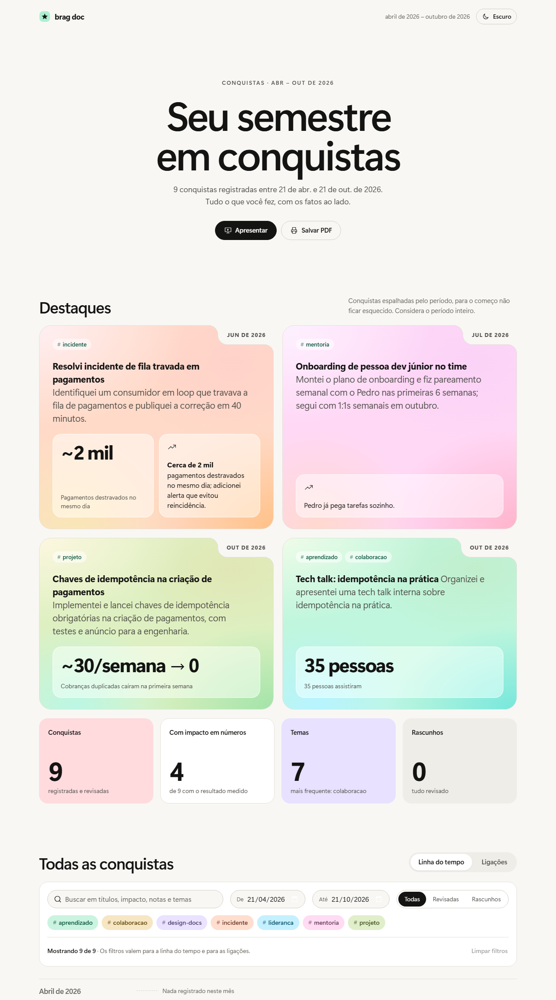

# brag-document

An Agent Skill that helps you keep a **brag document**: a private, living log of what you did at work and why it mattered.

## Credits

This skill started from Felipe Adamoli's class *Brag Document: registrando entregas e combatendo síndrome do impostor* at [Tech Leads Club](https://www.techleads.club/). The class showed how a brag document fights faulty memory, recency bias and impostor syndrome, and how AI can gather your accomplishments from the tools you already use. It also builds on Julia Evans' [Get your work recognized: write a brag document](https://jvns.ca/blog/brag-documents/) and Elton Minetto's [Brag document](https://eltonminetto.dev/post/2022-04-14-brag-document/).

*Português:* uma skill para manter seu brag document com uma conversa semanal de ~15 minutos. O agente conversa no seu idioma.

## What it does

- **Weekly check-in, about 15 minutes.** The agent gathers candidates from your sources, you pick what goes in, it drafts each entry and asks one question to pin down the impact. Missed weeks are covered without guilt.
- **Edit by conversation.** "Add the latency number to the API migration entry." The agent shows the change before writing it.
- **Recall.** "Have I done something like this before?" You get facts from your own log, not pep talk.
- **Period summary** for performance reviews and promotion cases, by theme or by your company's criteria.
- **Interactive view.** A single local HTML page with a timeline, highlights with your impact numbers, filters, a links graph and a presentation mode. It opens in your browser, light by default with a button for the dark theme, and makes no network requests. Prefer plain text? Ask for the Markdown view instead.
- **One-way sync to Notion**, as a filterable showcase.

*The interactive view, built from fictional data. **[Open the live example](https://renanantonini.github.io/brag-document/examples/view-example.html)** to try the filters, the links graph and the presentation mode, or download [examples/view-example.html](examples/view-example.html) and open it locally.*

## Privacy

- The skill **only reads** your sources (git, tasks, calendar, email, transcripts). It never sends, replies or changes anything there. The one exception: it can create a weekly reminder in your calendar, and only if you explicitly say yes.
- **Nothing is saved without your confirmation.**
- Entries store **a short summary plus a reference** (a link, or subject + date + sender). They never store email bodies or transcript excerpts.
- Before anything is published to Notion, you see what will go out and can anonymize colleagues' names.

Your log lives in a local folder that you control. Treat it like any personal file with work information in it, and check your company's policy before you push it to a public repository.

## Storage

A folder in [Open Knowledge Format](https://github.com/GoogleCloudPlatform/open-knowledge-format) v0.2: one Markdown file per entry under `YYYY/MM/`, plus a generated `log.md`. The folder is ready to open as an Obsidian vault and works in any editor and in git. Settings live in `~/.brag-document/config.yaml`.

## Install

- **Claude Code plugin:** `/plugin marketplace add renanantonini/brag-document`, then `/plugin install brag-document@brag-document`.
- **skills CLI:** `npx skills add renanantonini/brag-document`.
- **Manual:** copy `skills/brag-document/` into your skills folder (`~/.claude/skills/` for Claude Code).

Then say "let's start my brag document" or run `/brag-document`. First-time setup takes about 5 minutes.

The helper script needs Python 3.8+ (standard library only). Local folders and git need an agent with file access (Claude Code, for example). On claude.ai the skill works with connectors and pasted text only.

## Development

- `evals/` holds the test scenarios and a fictional bundle with sample source data.
- [CHANGELOG.md](CHANGELOG.md) lists what changed in each version.
## License

MIT
